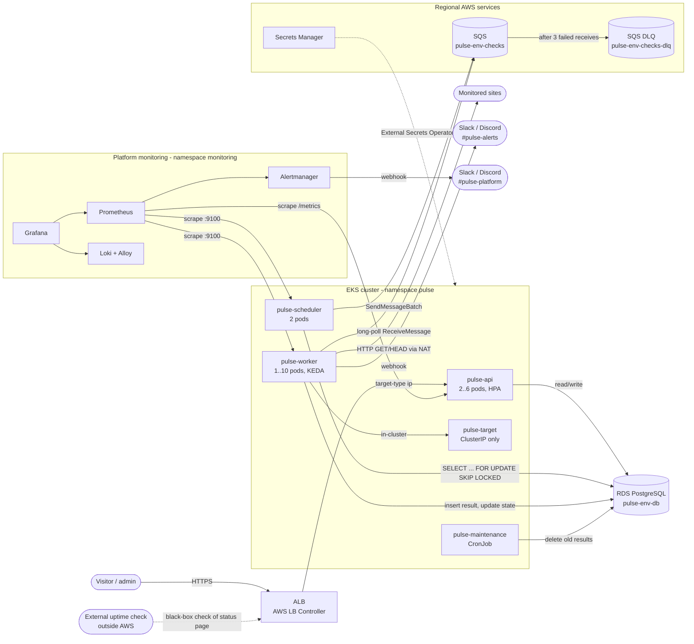
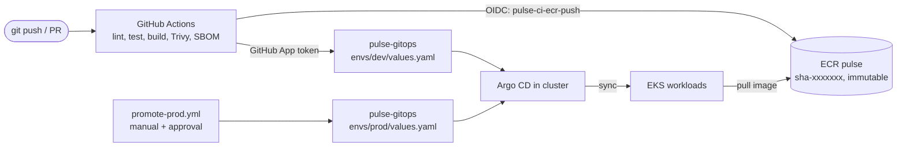

# Architecture

Pulse is an uptime monitoring service. Users register URLs; Pulse checks them on an interval, records
status and latency, tracks TLS expiry, opens incidents after repeated failures, sends Slack/Discord
notifications, and serves a public status page.

The application is deliberately small. Most of the design work is in the platform around it:
Terraform-managed AWS infrastructure, CI with OIDC and a pinned supply chain, GitOps with Argo CD,
autoscaling, observability, and documented incident response.

Shared names (queues, secrets, service accounts, metrics) are pinned in [CONTRACT.md](CONTRACT.md).
Design decisions are recorded in [adr/](adr/README.md).

## Overview diagram

```
                         ┌─────────────────── GitHub: pulse repo ────────────────────┐
   git push ───────────▶ │ Actions: lint → test → build → Trivy scan → push to ECR    │
                         │          → bump image tag in pulse-gitops (envs/dev)        │
                         └──────────────────────────────┬─────────────────────────────┘
                                                        │ commit
                         ┌──────────── GitHub: pulse-gitops repo ─────────────┐
                         │ Helm chart + per-env values + Argo CD apps          │
                         └──────────────────────────────┬─────────────────────┘
                                                        │ Argo CD pulls (GitOps)
┌──────────────────────────────── AWS account, VPC across 2 AZs ─────────────────────────────────┐
│  Public subnets:   ALB (created by AWS Load Balancer Controller) · NAT gateway                  │
│  Private subnets:  EKS managed node group                                                       │
│     ┌──────────────────────────────── EKS cluster ─────────────────────────────────────┐        │
│     │  namespace pulse:     pulse-api (2+, HPA)   pulse-scheduler (2)                   │        │
│     │                       pulse-worker (1..N, KEDA on SQS depth)   pulse-target       │        │
│     │  platform namespaces: Argo CD · kube-prometheus-stack · Loki + Alloy · KEDA       │        │
│     │                       External Secrets Operator · AWS LB Controller · metrics-server│      │
│     └───────────────────────────────────────────────────────────────────────────────────┘        │
│  Database subnets: RDS PostgreSQL (private, encrypted, SSL enforced)                            │
│  Regional services: SQS (checks queue + DLQ) · Secrets Manager · ECR · CloudWatch               │
└─────────────────────────────────────────────────────────────────────────────────────────────────┘
```

### Runtime data flow (Mermaid)



### Delivery flow (Mermaid)



CI never holds cluster credentials. It only pushes an image and a git commit; Argo CD, running
inside the cluster, pulls the change. See [ADR 0005](adr/0005-separate-gitops-repo-updated-by-ci.md).

## Components

| Component | Runs as | Purpose | Scaling | Ports |
|---|---|---|---|---|
| `pulse-api` | Deployment, namespace `pulse` | REST API, status page, `/metrics` | HPA on CPU 70%, min 2, max 6 | 8000 |
| `pulse-scheduler` | Deployment, 2 replicas | Finds due monitors, enqueues checks to SQS | Fixed; replicas coordinate with `SKIP LOCKED` | 9100 (health/metrics) |
| `pulse-worker` | Deployment, replicas owned by KEDA | Runs HTTP checks, stores results, opens/resolves incidents, sends notifications | KEDA `aws-sqs-queue` scaler, ~50 messages per pod, min 1, max 10 | 9100 |
| `pulse-target` | Deployment + ClusterIP Service | Chaos target with `/ok`, `/slow`, `/flaky`, `/status/{code}`, `/switch` | 1 replica (switch state is in memory) | 8080 |
| `pulse-maintenance` | CronJob, daily | Deletes `check_results` older than `PULSE_RETENTION_DAYS` in batches | n/a | n/a |
| Migrations | Argo CD PreSync Job | `alembic upgrade head` before each sync | n/a | n/a |
| RDS PostgreSQL | `pulse-<env>-db` | Monitors, check results, incidents | Single-AZ in dev, Multi-AZ in prod | 5432 |
| SQS | `pulse-<env>-checks` + `pulse-<env>-checks-dlq` | Work queue between scheduler and workers | Managed | n/a |
| Secrets Manager | `pulse/<env>/app`, `pulse/<env>/grafana`, `pulse/<env>/alertmanager`, RDS-managed master secret | Secret values, synced into Kubernetes by External Secrets Operator | n/a | n/a |

All Pulse processes run from one container image with different commands
([ADR 0003](adr/0003-one-image-multiple-entrypoints.md)).

### Platform add-ons

| Add-on | Namespace | Why |
|---|---|---|
| Argo CD | `argocd` | GitOps: syncs `pulse-gitops` into the cluster (app-of-apps) |
| AWS Load Balancer Controller | `kube-system` | Creates the ALB from the `pulse-api` Ingress |
| Cluster Autoscaler | `kube-system` | Adds nodes when pods are Pending |
| metrics-server | `kube-system` | CPU metrics for the HPA |
| External Secrets Operator | `external-secrets` | Copies Secrets Manager values into Kubernetes Secrets |
| KEDA | `keda` | Scales workers on SQS queue depth |
| kube-prometheus-stack | `monitoring` | Prometheus, Alertmanager, Grafana, kube-state-metrics, node-exporter |
| Loki + Alloy | `monitoring` | Log storage and the DaemonSet that ships pod logs |

AWS permissions are granted per service account through EKS Pod Identity
([ADR 0011](adr/0011-eks-pod-identity-over-irsa.md)). `pulse-api` has no AWS permissions.

## Data flow

1. An admin creates a monitor with `POST /api/v1/monitors` (`X-API-Key` header). The API validates
   the URL against the SSRF rules ([ADR 0007](adr/0007-ssrf-protection-for-user-urls.md)) and
   stores it with `next_check_at = now()`.
2. Every 5 seconds each scheduler replica opens a transaction, selects up to 500 due monitors with
   `FOR UPDATE SKIP LOCKED`, sends one SQS message per check
   (`{"monitor_id": "...", "scheduled_for": "<next_check_at>"}`) in batches of 10, advances
   `next_check_at`, and commits ([ADR 0002](adr/0002-scheduler-select-for-update-skip-locked.md)).
   If a monitor is overdue (for example after scheduler downtime), the next check is set to
   `now() + interval` rather than replaying every missed interval.
3. Workers long-poll SQS (`WaitTimeSeconds=20`, up to 10 messages), limit concurrency with a
   semaphore (`PULSE_WORKER_CONCURRENCY`, default 50), re-validate the URL, run the check, follow
   redirects manually (max 3 hops, each validated), and classify the result.
4. In one transaction the worker inserts the result with
   `ON CONFLICT (monitor_id, scheduled_for) DO NOTHING`, locks the monitor row, updates status and
   `consecutive_failures`, and runs the incident state machine. After commit it sends notifications,
   then deletes the SQS message.
5. On an unhandled error the message is not deleted. SQS makes it visible again after the 60-second
   visibility timeout; after 3 receives it moves to the DLQ.
6. The API serves the status page and JSON stats from Postgres.
7. Prometheus scrapes the API (`:8000/metrics`), scheduler and workers (`:9100/metrics`).
   Alertmanager routes platform alerts to `#pulse-platform`. Loki stores logs shipped by Alloy.

### Delivery guarantees

| Property | Mechanism |
|---|---|
| At-least-once processing | SQS standard queue; message deleted only after DB commit |
| Duplicate results are harmless | `UNIQUE (monitor_id, scheduled_for)` + `ON CONFLICT DO NOTHING`; duplicates skip state updates and notifications |
| One open incident per monitor | Partial unique index `UNIQUE (monitor_id) WHERE resolved_at IS NULL` |
| Stale work is discarded | Main queue retention is 1 hour: a check that is an hour late has no value |
| Poison messages are isolated | Redrive policy `maxReceiveCount = 3` to the DLQ (4-day retention) |

Known gap: notifications are sent after commit and are not persisted in an outbox. If a worker dies
after commit but before the webhook call succeeds, the redelivered message is treated as a duplicate
and that notification is lost. A transactional outbox is listed as a stretch goal.

## Network layout

| Subnet tier | CIDR (per AZ) | Contents | Route to internet |
|---|---|---|---|
| Public | `/24` | ALB, NAT gateway | Internet gateway |
| Private | `/20` | EKS nodes and pods (VPC CNI gives pods VPC IPs, prefix delegation on) | NAT gateway |
| Database | `/24` | RDS only | None |

VPC `10.20.0.0/16` across 2 AZs. Dev uses a single NAT gateway; prod uses one per AZ
([ADR 0009](adr/0009-single-nat-gateway-in-dev.md)). An S3 gateway endpoint carries ECR layer
downloads without NAT processing charges. The EKS API endpoint is public but restricted to the
owner's `/32`, plus private access. RDS accepts 5432 only from the cluster security group and
enforces SSL (`rds.force_ssl = 1`).

## Two layers of monitoring

| Layer | Type | What it watches | Implemented by | Alerts go to |
|---|---|---|---|---|
| 1. Product | Black-box (synthetic) | External URLs that users register | Pulse workers | `#pulse-alerts` |
| 2. Platform | White-box | Pulse itself: API, scheduler, workers, queue, pods, DB | Prometheus, Grafana, Alertmanager, Loki | `#pulse-platform` |

Black-box monitoring tests a system from the outside the way a user would and knows nothing about
its internals: "did `https://example.com` return 2xx within 5 s?". It detects symptoms.

White-box monitoring uses signals the system exposes about itself: request rates, error ratios,
queue depth, schedule lag, restart counts. It can explain why something is broken and can warn
before users notice (for example a growing backlog).

Platform alerts and their runbooks are listed in [runbooks/README.md](runbooks/README.md). SLOs and
burn-rate alerts are in [slo.md](slo.md).

## Failure modes

| Failure | Effect | Detection | Recovery |
|---|---|---|---|
| One API pod crashes | Other replica serves; PDB `minAvailable: 1` protects against voluntary disruption | `PulsePodCrashLooping` if repeated | Kubernetes restarts the pod |
| All API pods unready (bad deploy, DB down) | ALB returns 503; status page unavailable; checks keep running | ALB 5xx metrics, external uptime check. App metrics do not see ALB-generated 503s | `maxUnavailable: 0` keeps old pods during a bad rollout; `git revert` in `pulse-gitops` |
| Scheduler down | No new checks enqueued; queue drains; status page goes stale after 3 minutes | `PulseSchedulerDown` (2m), then `PulseChecksStalled` | Fix and restart; overdue monitors resume at `now() + interval` |
| Workers down or scaled to 0 | Queue grows; checks older than 1 hour expire | `PulseCheckBacklog`, `PulseChecksStalled`, stale banner | Restore workers; KEDA scales out to drain |
| Worker dies mid-check (OOM, node loss, spot interruption) | Message reappears after 60 s visibility timeout | `PulsePodCrashLooping` if repeated | Automatic redelivery; idempotent insert |
| RDS reboot or failover | API `/readyz` fails, pods leave the ALB; scheduler loop fails; workers fail messages | `PulseAPIHighErrorRate`, `PulseChecksStalled`, later `PulseDLQNotEmpty` | RDS recovers; messages that failed 3 receives during the outage are in the DLQ and need a decision (redrive or purge) |
| SQS unavailable | Scheduler send fails, transaction rolls back, `next_check_at` not advanced | `PulseChecksStalled`, scheduler error logs | Automatic when SQS recovers |
| Malformed message | Fails 3 times, moves to DLQ | `PulseDLQNotEmpty` | Inspect and delete, or fix and redrive |
| Slow monitored sites saturate workers | Schedule lag rises for all monitors (noisy neighbour) | `PulseScheduleLagHigh`, `PulseCheckBacklog` | Per-check timeout caps, more concurrency/replicas, separate queues |
| Slack/Discord webhook failing | Product notifications lost after 3 retries | `pulse_notifications_total{result="failure"}` | Fix webhook; no replay (see known gap above) |
| NAT gateway or its AZ fails (dev) | Workers cannot reach the internet: every external check fails; SQS calls fail unless a VPC endpoint is used | `PulseChecksStalled`, mass incidents | Prod uses one NAT per AZ |
| Argo CD down | No deploys; running workloads unaffected | Argo CD UI, platform alerts if configured | Restart Argo CD; nothing is lost because desired state is in git |
| Whole cluster or region down | Pulse and its in-cluster monitoring are down together | Only an external check can see this (next section) | Rebuild with `make infra-up` + `make argocd-bootstrap` |

## Who monitors the monitor?

Pulse cannot reliably detect its own total outage. Prometheus, Alertmanager and the workers run in
the same cluster, VPC, region and account as the thing they watch. If the cluster, the NAT gateway,
the region, or the notification path fails, every in-cluster signal fails with it, and silence looks
the same as "everything is fine".

The answer is independent layers, each with a different failure domain:

| Layer | What it catches | Shares fate with Pulse? |
|---|---|---|
| In-cluster Prometheus alerts | Component failures while the cluster is healthy | Yes: cluster, region, Alertmanager, Slack |
| Dead man's switch on the alert pipeline | Prometheus or Alertmanager down, or Alertmanager unable to deliver | No, if the receiver is outside AWS. kube-prometheus-stack ships an always-firing `Watchdog` alert; route it to an external service that alerts when the heartbeat stops |
| External black-box check of the public status page | ALB, API, DB, DNS, or whole-region outage as a user sees it | No: runs from a free external uptime service outside AWS |
| Freshness check | Pulse is serving pages but no checks are running (scheduler or workers dead) | Partly. An external keyword check that fails when the page shows the "data may be stale" banner covers this without cluster access |
| Second Pulse in another region (stretch) | Region-level failure, and gives multi-region checking for users | No |

The important subtlety: an external check that only asserts "HTTP 200 on `/`" proves the API is
serving, not that monitoring is working. Pulse can serve a green status page from stale data while
the workers are dead. That is why the status page shows a "data may be stale" banner when the newest
result is older than 3 minutes, and why the external check should assert on page content, not just
the status code.

The notification channel is also a shared dependency: both product and platform alerts go to the
same Slack/Discord workspace. The external service should notify through a different channel (email
or SMS) so a chat outage does not hide a Pulse outage.

TODO: record which external service was configured, what URL and assertion it checks, its interval,
and where it notifies. Add a screenshot to `docs/images/`.

## Scaling notes

- API: stateless; HPA on CPU. Bounded by RDS connections (pool size × replicas must stay under the
  instance's `max_connections`).
- Scheduler: two replicas share work through `SKIP LOCKED`. Throughput per loop is bounded by
  `PULSE_SCHEDULER_BATCH_SIZE` and SQS batch send latency.
- Workers: KEDA scales on visible messages; per-pod throughput is roughly
  `PULSE_WORKER_CONCURRENCY / average check duration`. Slow targets reduce throughput for everyone.
- Nodes: Cluster Autoscaler adds nodes when pods are Pending.
- Database: `check_results` is the largest and fastest-growing table. Retention runs daily;
  partitioning by day is a stretch goal.

Load-test results are in [load-test-results.md](load-test-results.md).
